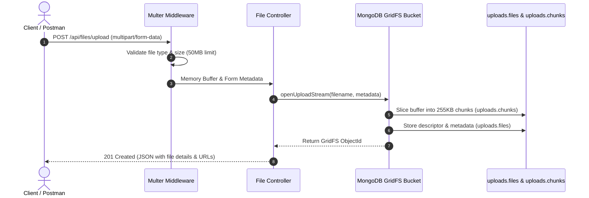

# SyntecxHub File Uploader 🚀

> **Task 1: Project 3 — File Uploader API & Dashboard**  
> Developed as part of the **SyntecxHub Virtual Internship Program**.  
> Repository Name: `Syntecxhub_File_Uploader`

A production-grade, high-performance **File Upload & Storage System** built with **Express 5**, **Multer**, **MongoDB GridFS**, and an interactive **React 19** dashboard. This application handles multipart file uploads, securely streams arbitrary file sizes beyond MongoDB's 16MB document limit using chunked GridFS storage, supports partial byte-range audio/video streaming, and delivers complete CRUD file lifecycle management.

---

## 🌟 Key Features

- **Direct Multer Memory Streaming**:
  - Employs `multer.memoryStorage()` for zero-disk-latency streaming directly into MongoDB GridFS.
  - Granular file validation: restricts dangerous executable extensions (`.exe`, `.sh`, `.bat`, etc.) and enforces strict 50MB file size limits.
  - Multi-file batch uploads up to 10 files simultaneously.
- **MongoDB GridFS Chunked Architecture**:
  - Automatically slices files into 255 KB BSON binary chunks distributed across `uploads.files` and `uploads.chunks`.
  - Atomic cleanup: deleting a file purges both the file descriptor and all associated binary chunks.
- **Smart Retrieval & Streaming**:
  - HTTP Range header support (`bytes=start-end`) enabling smooth audio and video seeking and low-latency previews.
  - Direct download endpoint forcing browser save dialogs via `Content-Disposition: attachment`.
- **Real-Time Storage Intelligence**:
  - Aggregated storage metrics: total files, total bytes, average file size, and per-MIME-category distributions (Images, Documents, Audio, Video, Archives, Code).
- **Interactive React 19 Client Dashboard**:
  - Modern drag-and-drop upload station with live progress indicators.
  - Dynamic file explorer with regex search, category filtering, and multi-directional sorting.
  - Media preview modal with embedded image viewer, video player, audio player, PDF viewer, and raw BSON metadata inspector.
  - Built-in REST API Documentation and cURL console.
  - Dark/Light mode design system with glassmorphic cards and micro-animations.
- **Automated Test Suite**:
  - Comprehensive standalone integration test suite verifying health, uploads, queries, streams, downloads, and invalid ID handling with 100% pass rate.

---

## 🏗️ Architecture & Data Flow



---

## 📡 RESTful API Reference

Base URL: `http://localhost:5000/api`

| Method | Endpoint | Description |
| :--- | :--- | :--- |
| `GET` | `/health` | System health check and MongoDB GridFS ping status |
| `GET` | `/files/stats` | Storage utilization summary and category breakdown |
| `POST` | `/files/upload` | Upload a single file via `file` field (`multipart/form-data`) |
| `POST` | `/files/upload-multiple` | Batch upload up to 10 files via `files` field |
| `GET` | `/files` | Query files with search (`?q=`), category (`?category=`), sort, and pagination |
| `GET` | `/files/:id` | Fetch file metadata and chunk count by 24-character ObjectId |
| `GET` | `/files/:id/view` | Stream file inline (supports `Range: bytes=start-end`) |
| `GET` | `/files/:id/download` | Force browser attachment download |
| `DELETE` | `/files/:id` | Delete file metadata and all associated GridFS chunks |

### Example cURL Commands

#### 1. Upload a File
```bash
curl -X POST "http://localhost:5000/api/files/upload" \
  -F "file=@/path/to/sample.png" \
  -F "uploader=SyntecxHub Intern" \
  -F "description=Architecture diagram"
```

#### 2. Get Storage Statistics
```bash
curl -X GET "http://localhost:5000/api/files/stats"
```

#### 3. Search Files
```bash
curl -X GET "http://localhost:5000/api/files?q=diagram&category=Image&sort=newest"
```

#### 4. Stream Audio/Video with Range Request
```bash
curl -H "Range: bytes=0-1048575" -I "http://localhost:5000/api/files/<FILE_ID>/view"
```

#### 5. Delete File
```bash
curl -X DELETE "http://localhost:5000/api/files/<FILE_ID>"
```

---

## 🧪 Postman Collection

A complete, pre-configured Postman Collection is included in the repository root:
[`Syntecxhub_File_Uploader_Postman_Collection.json`](./Syntecxhub_File_Uploader_Postman_Collection.json)

**How to use:**
1. Open Postman &rarr; Click **Import**.
2. Select `Syntecxhub_File_Uploader_Postman_Collection.json`.
3. Set your environment variable `baseUrl` to `http://localhost:5000`.
4. Run the upload requests—the test script will automatically capture and set `{{fileId}}` for subsequent retrieval, streaming, and deletion requests!

---

## ⚙️ Installation & Setup

### Prerequisites
- [Node.js](https://nodejs.org/) (v18 or higher)
- [MongoDB](https://www.mongodb.com/) (running locally or a MongoDB Atlas URI)

### 1. Clone Repository & Install Dependencies
```bash
git clone https://github.com/<your-username>/Syntecxhub_File_Uploader.git
cd Syntecxhub_File_Uploader
npm install
```

### 2. Configure Environment Variables
Copy `.env.example` to `.env` and update your connection string:
```bash
cp .env.example .env
```

Sample `.env`:
```env
PORT=5000
NODE_ENV=development

# MongoDB Connection String
MONGO_URI=mongodb://127.0.0.1:27017/syntecxhub_file_uploader
DB_NAME=syntecxhub_file_uploader
GRIDFS_BUCKET=uploads

# Upload Limits
MAX_FILE_SIZE_MB=50
MAX_FILES_COUNT=10
```

### 3. Run Automated Tests
```bash
npm test
```
All 31 assertions covering health, single uploads, batch uploads, search queries, streaming, attachment downloads, and deletion will execute and validate against the database.

### 4. Start the Application
Run both the Express API and Vite React client concurrently:
```bash
npm run dev
```
- **Backend API**: `http://localhost:5000`
- **Frontend Dashboard**: `http://localhost:5174`

Or build the production client and serve statically:
```bash
npm run build
npm run start
```

---

## 📂 Project Directory Structure

```text
Syntecxhub_File_Uploader/
├── server/
│   ├── config/
│   │   └── db.js                 # MongoDB connection & GridFS bucket initialization
│   ├── controllers/
│   │   └── fileController.js     # Upload, stream, download, stats, and delete handlers
│   ├── middleware/
│   │   ├── errorHandler.js       # Global error handler & standardized API errors
│   │   └── upload.js             # Multer memoryStorage & security filters
│   ├── routes/
│   │   └── fileRoutes.js         # RESTful router endpoints
│   └── server.js                 # Express application orchestrator & static hosting
├── src/
│   ├── components/
│   │   ├── ApiReferenceModal.jsx # Interactive REST docs & cURL console
│   │   ├── DeleteConfirmModal.jsx# Chunk destruction warning modal
│   │   ├── FileExplorer.jsx      # Grid/Table viewer, search, category pills & actions
│   │   ├── FilePreviewModal.jsx  # Inline media preview & GridFS chunk inspector
│   │   ├── FileUploadZone.jsx    # Drag & drop upload station with progress tracking
│   │   ├── Navbar.jsx            # Brand header & real-time MongoDB status pill
│   │   ├── StorageStats.jsx      # Storage metrics & category breakdown
│   │   └── Toast.jsx             # Real-time feedback alerts
│   ├── utils/
│   │   └── formatters.js         # Byte calculations, date formatters & badges
│   ├── App.css                   # Component styling & layouts
│   ├── App.jsx                   # React root orchestrator
│   ├── index.css                 # Design system tokens, variables & glassmorphism
│   └── main.jsx                  # React DOM entry point
├── test/
│   └── api.test.js               # 31-step automated integration test suite
├── Syntecxhub_File_Uploader_Postman_Collection.json
├── package.json
├── vite.config.js
└── README.md
```

---

## 💼 LinkedIn Sharing Template

Use this ready-to-post template to share your internship progress on LinkedIn (mandatory per internship instructions):

```text
🚀 Thrilled to share my latest project as a Web Development Intern at @Syntecxhub!

For Task 1 (Project 3), I developed "Syntecxhub_File_Uploader" — a production-grade File Uploader & Storage API powered by Express 5, Multer middleware, and MongoDB GridFS, accompanied by a modern React 19 interactive dashboard.

Key Highlights:
✨ Multipart/form-data upload pipeline using Multer memory storage.
📦 MongoDB GridFS chunking architecture to seamlessly store files beyond the 16MB BSON limit across 255KB chunks.
🎥 HTTP Range Partial Content streaming (HTTP 206) for video and audio seeking.
📊 Real-time storage analytics and MIME category breakdown.
🛡️ Strict security filters restricting executable files and enforcing file size bounds.
🧪 100% automated test coverage with 31 integration assertions & ready-to-use Postman collection.

A big thank you to the team and mentors at @Syntecxhub for this hands-on learning opportunity!

🔗 GitHub Repository: https://github.com/<your-username>/Syntecxhub_File_Uploader

#Syntecxhub #WebDevelopment #MongoDB #GridFS #Multer #NodeJS #ExpressJS #ReactJS #FullStack #Internship
```

---

## 📝 Internship Submission Checklist

- [x] Implemented API handling file uploads with Multer middleware (`multipart/form-data`).
- [x] Stored uploaded files in MongoDB using GridFS chunked storage (`uploads.files` and `uploads.chunks`).
- [x] Implemented file retrieval (`/api/files`, `/api/files/:id`, `/api/files/:id/view`, `/api/files/:id/download`).
- [x] Implemented file deletion (`DELETE /api/files/:id`) cleaning up both metadata and chunks.
- [x] Built robust error handling, executable file filtering, and size limit validations.
- [x] Created interactive React 19 management dashboard with Dark/Light mode and media preview.
- [x] Added automated test suite (31/31 passing tests) and Postman Collection.
- [x] Git repository created named `Syntecxhub_File_Uploader`.
- [ ] Post status on LinkedIn mentioning `@Syntecxhub`.
- [ ] Submit project link via official SyntecxHub Submission Form.
